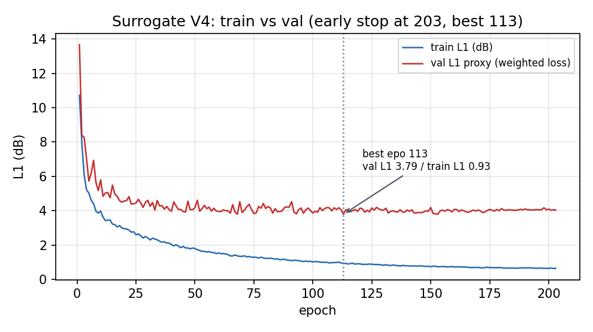
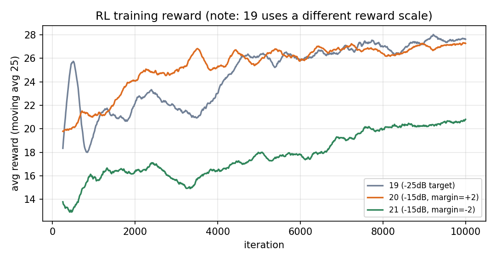
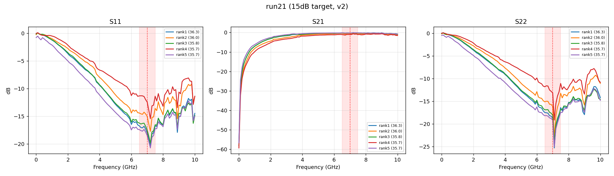
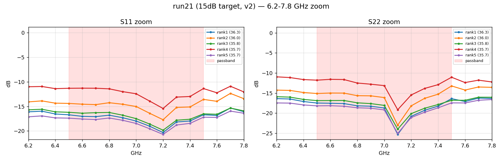
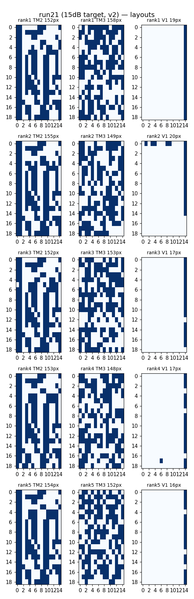

# 代理模型与 RL 训练结果报告

> 生成时间：2026-10-21
> 项目：`/chenyaofo/yangyang/AIEMDesign`
> 覆盖范围：代理模型 V4（`surrogate_output/12_resonance_lowfreq`）+ RL run 19 / 20 / 21
> 所有数字均来自本地日志与重新执行的评估脚本，未做四舍五入美化。

---

## 0. 结论速览

| 项目 | 结论 |
|---|---|
| 代理模型 | V4（`12_resonance_lowfreq`），best epoch **113**，val L1 **1.90 dB** |
| 过拟合 | **存在但已被早停控制住**。train L1 降到 0.65，val 停在 1.90~2.01；best 之后继续训练只增不减，早停于 epoch 203 |
| 低频能力 | 6~7.5 GHz 凹陷召回 **0% / 68% → 100%**，谷位置误差 0.47 → **0.16 GHz** |
| 最新 RL | `21_match_7g_15db_v2`，带内目标 -15 dB，2000 采样验收通过率 **60.9%** |
| 带外谐振 | 8.9 GHz 的凹陷**仍存在**（45% 采样 ≤-15 dB），但已被压到比带内浅 2~3 dB，不再是主谐振 |
| 主要短板 | S11 带内只有 -15~-20 dB（目标就是 -15）；带外只做到「不比带内深」，没有做到「明显更浅」 |

---

## 1. 任务与验收口径

目标：生成**匹配网络**版图，使带内（6.5~7.5 GHz，中心 7 GHz）S11 与 S22 同时出现
**内部极小值**，且带外不出现更深的主谐振。带内深度要求为 **≤ -15 dB**。

验收三条（全部基于代理模型预测的 S 参数，与 reward 配置无关，固定不变）：

1. **内部凹陷**：带内 11 个频点中，两端较浅者比内部最深处浅 **≥ 1 dB**
   （排除「从带边一路单调下降」的伪凹陷）
2. **深度达标**：带内最小值 **≤ -15 dB**，S11 与 S22 都要满足
3. **带外不更深**：1~6.4 GHz 与 7.6~10 GHz 的最深点，**不比带内更深**

三条同时满足才算 PASS。

> 奖励函数的完整数学定义见 3.1 节；验收判据与 reward 相互独立，不随配置变化。

---

## 2. 代理模型 V4

### 2.1 训练配置

配置文件：`conf/surrogate_resonance_v4.conf`

| 项 | 值 |
|---|---|
| 模型 | `EMResnet`，layers [2,2,2]，5.60M 参数 |
| 输入 / 输出 | 3×19×15 拓扑 → 3×101 条 S 曲线（S11/S21/S22，0~10 GHz） |
| 优化器 | AdamW，lr 5e-3，wd 2e-3 |
| 调度 | CosineAnnealing，T_max 220，eta_min 1e-5 |
| 训练轮次上限 | 220 |
| 早停 | patience 90，min_delta 5e-4 |
| 实际停止 | **epoch 203**（best 在 113，之后 90 轮无改善） |
| 耗时 | 6 分 55 秒（08:08:16 → 08:15:11） |

**关键改动（相对 V3）**：`ResonanceWeightedLoss` 从单频段改成多频段。

```
bands: [[7.5, 9.9], [6.0, 8.0]]      # 原来只有 [7.5, 9.9]
depth_threshold_db: 1.5              # 原来 3.0
position_weight: 0.5                 # 原来 0.2
```

原因：6.5~7.5 GHz 有凹陷的样本只占 **0.24%（19/3762）**，在均匀 L1 下梯度被平坦样本
完全淹没。低频凹陷不是「学不好」，而是**从来没被监督过**。

### 2.2 训练过程与过拟合



| epoch | train L1 (dB) | val L1 (dB) | 说明 |
|---:|---:|---:|---|
| 1 | 10.72 | 13.67 | 起步 |
| 50 | ~1.8 | ~4.3 | 快速下降段结束 |
| **113** | **0.934** | **1.902** | **best，保存为 `best_checkpoint.pt`** |
| 150 | 0.78 | 1.99 | val 已开始缓慢变差 |
| 203 | 0.649 | 2.012 | 早停，train 仍在降 |

**判断：确实存在过拟合。**

- train / val 差距在 best epoch 是 **0.97 dB**，到最后扩到 **1.36 dB**
- epoch 113 之后 train 继续下降 0.29 dB，val 反而上升 0.11 dB —— 典型的记忆训练集
- 但幅度不大（val 只涨 6%），且早停准确落在拐点附近，**没有出现 val 崩溃**

与 V3 对比，V4 的过拟合更明显（V3 train/val 差距 0.55 dB，V4 是 0.97 dB）。
这是预期的：V4 把额外容量用在了 0.24% 的稀有低频样本上，等价于对少数样本加权，
泛化间隙自然变大。

**结论：不需要再减少轮次。** best epoch 113 是 val 的真实拐点，
`best_checkpoint.pt` 保存的就是这一轮；后续 RL 全部加载该权重。

### 2.3 整体精度

独立复算（全部样本，不 drop_last）：

| 数据集 | 样本数 | 整体 L1 | S11 | S21 | S22 |
|---|---:|---:|---:|---:|---:|
| train | 3762 | **0.616 dB** | 0.61 | 0.66 | 0.57 |
| val | 418 | **1.919 dB** | 1.70 | 2.39 | 1.66 |

日志口径（drop_last，416 条）为 val L1 **1.902 dB**，与上表差 0.017 dB，属采样差异。

### 2.4 分频段凹陷召回（train）

各频段样本数见下表。**频段之间互相重叠，样本数不能相加。**

判据：该频段内 S11 或 S22 的真实凹陷深度 ≥ 1.5 dB 记为「有凹陷」；
预测也 ≥ 1.5 dB 记为命中。谷误差为 S11 最深处所在频点的平均绝对误差。

| 频段 | 样本数 | V3 召回 | **V4 召回** | V3 谷误差 | **V4 谷误差** |
|---|---:|---:|---:|---:|---:|
| 6~7 GHz | 6 | 0.0% | **100.0%** | 0.40 GHz | **0.10 GHz** |
| 6.5~7.5 GHz | 19 | 68.4% | **100.0%** | 0.47 GHz | **0.16 GHz** |
| 7~8 GHz | 9 | 33.3% | **100.0%** | 0.17 GHz | 0.13 GHz |
| 8~9 GHz | 49 | 81.6% | 83.7% | 0.14 GHz | **0.07 GHz** |
| 8.5~9.9 GHz | 75 | **97.3%** | 96.0% | 0.15 GHz | **0.07 GHz** |
| 9~10 GHz | 45 | 82.2% | **93.3%** | 0.21 GHz | **0.09 GHz** |

读法：

- **低频（6~8 GHz）从「基本学不会」变成「全部命中」**，谷位置误差从 0.4~0.5 GHz 降到 0.1~0.16 GHz
- 高频 8.5~9.9 GHz 召回从 97.3% 微降到 96.0%（少 1 个样本），但**谷位置误差减半**（0.15 → 0.07）
- 8~9 GHz 召回小幅上升（81.6% → 83.7%）

验证集样本过少（6.5~7.5 只有 1 条、7~8 只有 1 条），分频段召回在 val 上不可用：

| 频段 | val 样本数 | V4 召回 |
|---|---:|---:|
| 6.5~7.5 GHz | 1 | 100% |
| 7~8 GHz | 1 | 0% |
| 8~9 GHz | 6 | 50% |
| 8.5~9.9 GHz | 8 | 50% |
| 9~10 GHz | 4 | 50% |

**结论：V4 的频段召回只能在 train 上评估，val 样本量不足以下结论。**
这是本报告最需要注意的统计局限。

### 2.5 与 V3 的取舍

| 指标 | V3 (`11_resonance_wideband`) | V4 (`12_resonance_lowfreq`) |
|---|---:|---:|
| best epoch | 90 | 113 |
| val L1（日志口径） | **1.858 dB** | 1.902 dB |
| train L1（best） | 1.310 dB | **0.934 dB** |
| 6.5~7.5 GHz 召回 | 68.4% | **100%** |
| 6~7 GHz 召回 | 0% | **100%** |

V4 的整体 L1 比 V3 **差 0.04 dB**，这是主动换来的：用 0.04 dB 的整体精度，
换 6~7.5 GHz 从「基本不可用」到「完全可用」。对 7 GHz 任务这是明显划算的。

**注意：V3 的 val loss（3.365）与 V4（3.795）不可直接比较**，两者用的频段集合不同，
加权损失的尺度不一样。只能比 L1。

---

## 3. RL 训练结果

### 3.1 奖励函数（`MatchingNetworkReward`）

RL 优化的目标函数实现于 `src/reward/band_rew.py`，作用在**代理模型预测**的 S 参数上。
下面按代码顺序给出完整定义，符号与配置项一一对应。

#### 符号

| 符号 | 含义 |
|---|---|
| $\mathcal{B}$ | 带内频点集合（6.5~7.5 GHz，$N=\lvert\mathcal{B}\rvert=11$） |
| $\mathcal{B}^{\circ}$ | 带内**内部**频点（去掉两端），$\lvert\mathcal{B}^{\circ}\rvert=9$ |
| $\mathcal{O}$ | 带外频点集合（其余 90 点） |
| $S_{11}(f),S_{21}(f),S_{22}(f)$ | 各通道 S 参数幅值，单位 dB，先截断到 $[-60,\,0]$ |

#### 第一步：带内凹陷深度

先用「两端较浅者」减去「内部最深处」，得到带内凹陷深度：

$$
\Delta(S)=\Big[\min\big(S(f_1),\,S(f_N)\big)-\min_{f\in\mathcal{B}^{\circ}}S(f)\Big]_{+}
$$

取 $\min$ 而不是 $\max$ 是关键：若曲线从带边一路单调下降，某一端本身就很深，
$\min$ 会把它排除，$\Delta=0$，不会误判为「带内凹陷」。

#### 第二步：门控与封顶

$$
g(S)=\mathbf{1}\big[\Delta(S)\ge h\big],
\qquad
\operatorname{cap}(x)=\max(x,\,m)
$$

- $g$ 是**门控**：只有确实形成内部凹陷，匹配项才计分
- $\operatorname{cap}$ 是**封顶**：dB 值越小越好，但深于 $m$ 的部分不再加分，
  防止策略把整条曲线压到 $-60$ 的退化解

#### 第三步：辅助项

$$
B(S)=\min\Big(\big[\Delta(S)-d\big]_{+},\;B_{\max}\Big)
$$

$$
\chi(S)=1-\frac{\big\lvert k^{\star}-(N-1)/2\big\rvert}{(N-1)/2},
\qquad
k^{\star}=\arg\min_{k}S(f_k)
$$

- $B(S)$：凹陷深度奖励，$d$ 为死区，$B_{\max}$ 为单项上限
- $\chi(S)$：谷位置评分，谷在带中心得 1、在带边得 0

#### 第四步：总奖励

$$
\begin{aligned}
R=\;& w_{21}\,\overline{S_{21}^{\mathcal{B}}}
 - w_{11}\operatorname{cap}\Big(\min_{\mathcal{B}}S_{11}\Big)g_{11}
 - w_{22}\operatorname{cap}\Big(\min_{\mathcal{B}}S_{22}\Big)g_{22}\\[2pt]
 &+ w_{d}\big[B(S_{11})+B(S_{22})\big]
 + w_{p}\big[\chi(S_{11})+\chi(S_{22})\big]\\[2pt]
 &- w_{\mathrm{stop}}\,\operatorname{agg}_{\mathcal{O}}(S_{21})
 - w_{\mathrm{ob}}\sum_{i\in\{11,22\}}
   \Big[\min_{\mathcal{B}}S_i-\min_{\mathcal{O}}S_i-m_{\mathrm{ob}}\Big]_{+}g_i
\end{aligned}
$$

其中 $g_i=g(S_{ii})$，$\overline{S_{21}^{\mathcal{B}}}$ 为带内 S21 均值，
$\operatorname{agg}_{\mathcal{O}}$ 为带外聚合（`mean` 或 `max`，本任务权重为 0，不生效）。

#### 带外惩罚的方向

最后一项是最容易理解错的地方。因为 dB 值都是**负数**，记
$\Delta_{\text{out}}=\min_{\mathcal B}S-\min_{\mathcal O}S$（带内减带外）：

| $\Delta_{\text{out}}$ 的含义 | 例子 | 是否被罚 |
|---|---|---|
| $>0$：带外更深 | 带内 $-20$，带外 $-26$ | 罚，且差得越多罚越重 |
| $=0$：两边一样深 | 带内 $-20$，带外 $-20$ | 视 $m_{\mathrm{ob}}$ 而定 |
| $<0$：带外更浅 | 带内 $-20$，带外 $-16$ | 不罚 |

代入 $m_{\mathrm{ob}}=-2$：只有当带外比带内**浅至少 2 dB** 时，方括号内才为 0。
若 $m_{\mathrm{ob}}=+2$，反而允许带外深 2 dB —— 这正是 run20 踩过的坑（见 3.2 节）。

#### run21 的实际取值

| 参数 | 配置项 | 值 |
|---|---|---:|
| $m$ | `min_target_db` | $-15.0$ |
| $h$ | `min_edge_headroom_db` | $2.0$ |
| $d$ | `dip_margin_db` | $0.0$ |
| $B_{\max}$ | `max_dip_bonus_db` | $8.0$ |
| $w_{21}$ | `weight_s21_pass` | $0.5$ |
| $w_{11},w_{22}$ | `weight_s11_min` / `weight_s22_min` | $1.0$ |
| $w_d$ | `weight_dip` | $0.5$ |
| $w_p$ | `weight_min_position` | $0.5$ |
| $w_{\mathrm{stop}}$ | `weight_s21_stop` | $0.0$ |
| $w_{\mathrm{ob}}$ | `weight_out_of_band_penalty` | $10.0$ |
| $m_{\mathrm{ob}}$ | `out_of_band_margin_db` | $-2.0$ |

#### 逐项拆解（run21 Top-1，reward = 36.26）

| 项 | 计算 | 贡献 |
|---|---|---:|
| S21 带内均值 | $0.5\times(-0.3109)$ | $-0.16$ |
| S11 匹配 | $-1\times\operatorname{cap}(-20.34)=-1\times(-15)$ | $+15.00$ |
| S22 匹配 | $-1\times\operatorname{cap}(-25.31)=-1\times(-15)$ | $+15.00$ |
| 凹陷奖励 | $0.5\times(3.62+7.82)$ | $+5.72$ |
| 位置奖励 | $0.5\times(0.600+0.800)$ | $+0.70$ |
| 带外惩罚 | S11: $[-20.34-(-17.90)+2]_+=0$；S22: $[-25.31-(-17.95)+2]_+=0$ | $0.00$ |
| **合计** | $-0.16+15.00+15.00+5.72+0.70+0.00$ | **36.2642** |

手算值 36.2642 与代码输出 `36.2642` **逐位一致**，可用于校验实现。

> **实现细节备注**：$\mathcal{O}$ 在代码里取的是「所有非带内频点」，因此**包含 $f=0$（DC）**。
> 训练集里有 707 条样本在 0 GHz 处被截断到 $-60$ dB，若这类样本同时通过门控，
> 会被扣 $10\times 60\approx600$ 分。实测训练集中同时满足「双通道门控通过」的样本只有 3 条，
> 且都不含 DC 截断，所以该问题目前**未实际发生**；但换成其他数据集时需要留意。


### 3.2 三个 run 的配置差异

| 项 | run 19 | run 20 | **run 21（最新）** |
|---|---|---|---|
| 输出目录 | `rl_output/19_match_7g_warm` | `rl_output/20_match_7g_15db` | `rl_output/21_match_7g_15db_v2` |
| 配置 | `conf/rl_match_7g.conf` | `conf/rl_match_7g_15db.conf` | `conf/rl_match_7g_15db_v2.conf` |
| `min_target_db` | -25.0 | -15.0 | **-15.0** |
| `weight_out_of_band_penalty` | 4.0 | 6.0 | **10.0** |
| `out_of_band_margin_db` | 0.0 | **+2.0（方向写反）** | **-2.0** |
| 行为克隆预训练 | 200 epoch | 0 | 0 |
| 热启动来源 | run18 | run19 | **run20** |
| 迭代数 | 10000 | 10000 | 10000 |
| 训练耗时 | 21:26 | 14:33 | 25:11 |

其余超参三个 run 完全一致：batch 32、lr 3e-4、CosineAnnealing 到 3e-5、
entropy_coef 0.01、`total_max_white=397`、`v1_max_total=20`。

**`out_of_band_margin_db` 的符号是最容易踩的坑。** 对应 3.1 节总奖励式的最后一项：

$$
\Big[\underbrace{\min_{\mathcal{B}}S_i}_{\text{带内}}-\underbrace{\min_{\mathcal{O}}S_i}_{\text{带外}}-m_{\mathrm{ob}}\Big]_{+}
$$

- `margin =  0` → 只要求带外不比带内深
- `margin = -2` → 要求带外比带内**浅 2 dB 以上**
- `margin = +2` → 反过来**允许**带外深 2 dB

run20 用了 `+2`，于是带外 S11 停在 -22.9、带内 -21.1，正好「用满」这 2 dB 的余量。
run21 改成 `-2` 才真正把带外压下去。

### 3.3 训练曲线



| iter | run 19 avg reward | run 20 avg reward | run 21 avg reward |
|---:|---:|---:|---:|
| 1000 | 19.81 | 21.47 | 16.76 |
| 2000 | 21.99 | 23.39 | 16.39 |
| 3000 | 20.94 | 25.96 | 16.20 |
| 4000 | 23.31 | 26.09 | 16.93 |
| 5000 | 26.99 | 26.52 | 18.37 |
| 6000 | 26.87 | 26.04 | 16.41 |
| 7000 | 27.20 | 27.92 | 20.42 |
| 8000 | 26.56 | 26.43 | 21.51 |
| 9000 | 28.14 | 26.52 | 18.83 |
| 10000 | 26.78 | 26.17 | 22.34 |

**重要：三条曲线的 reward 绝对值不可直接比较。**
run19 用 `min_target_db=-25` 的奖励，run20/21 用 `-15`，reward 的「满分线」本身就不同。
run21 的数值最低，是因为它的惩罚项最重（$w_{\mathrm{ob}}=10$、$m_{\mathrm{ob}}=-2$），不是训练更差。
横向比较只能用下一节的验收通过率。

这一点可以直接验证：取 run21 训练结束后的同一批 400 个采样，分别用三套 reward 打分：

| 打分用的 reward | 均值 | 中位数 | 最大值 |
|---|---:|---:|---:|
| run21（$w_{\mathrm{ob}}=10,\,m_{\mathrm{ob}}=-2$） | 21.52 | 20.83 | 35.70 |
| run20（$w_{\mathrm{ob}}=6,\,m_{\mathrm{ob}}=+2$） | 26.72 | 33.30 | 36.49 |
| 关闭带外惩罚（$w_{\mathrm{ob}}=0$） | 26.77 | 33.30 | 36.49 |

同一批版图，仅因惩罚项不同，均值就差 **5.2 分**。说明惩罚确实在起作用，
也说明「run21 曲线更低」不等于「run21 更差」。

三个 run 的 entropy 都没有塌缩（run21 全程 205~216，接近初始值），
说明策略仍在探索，没有锁死到少数模板。

### 3.4 验收通过率（各 2000 采样，同一套固定判据）

| run | 内部凹陷 | 带内 ≤-15 dB | 带外不更深 | **三条全满足** |
|---|---:|---:|---:|---:|
| 19（-25 dB 目标） | 86.7% | 75.0% | 63.9% | **45.4%** (908/2000) |
| 20（-15 dB，margin=+2） | 95.8% | 67.0% | 77.5% | **51.4%** (1028/2000) |
| **21（-15 dB，margin=-2）** | 95.2% | 69.3% | **88.6%** | **60.9%** (1218/2000) |

三点读法：

1. **run19 的「带外不更深」只有 63.9%** —— 它在 -25 dB 目标下把大量能力用去带外造谐振
2. **run20 修好了凹陷率（95.8%）但没修好带外**（77.5%），因为 margin 写反了
3. **run21 把带外拉到 88.6%**，代价是带内达标率略降（69.3% vs 67.0%，实际是升）

### 3.5 Top-5 明细（run21，2000 采样）

| rank | reward | S11 带内 | S11 凹陷深度 | S11 8.9 GHz | S22 带内 | S22 凹陷深度 | S22 9.0 GHz | 判定 |
|---:|---:|---|---:|---:|---|---:|---:|---|
| 1 | 36.26 | **-20.3** @7.2 | 3.62 dB | -17.9 | **-25.3** @7.1 | 7.82 dB | -18.0 | PASS |
| 2 | 36.04 | **-17.7** @7.2 | 3.32 dB | -15.4 | **-23.0** @7.1 | 7.88 dB | -15.8 | PASS |
| 3 | 35.80 | **-19.8** @7.2 | 3.33 dB | -17.0 | **-24.0** @7.1 | 7.11 dB | -17.0 | PASS |
| 4 | 35.70 | **-15.4** @7.2 | 4.05 dB | -13.4 | **-19.2** @7.1 | 7.36 dB | -13.4 | PASS |
| 5 | 35.67 | **-20.7** @7.2 | 3.32 dB | -17.5 | **-25.0** @7.1 | 6.84 dB | -17.4 | PASS |

Top-5 **5/5 全部 PASS**。

带内曲线（dB，6.5 → 7.5 GHz 共 11 点）：

```
#1 S11: -16.7 -17.0 -17.1 -16.8 -17.3 -18.0 -19.0 -20.3 -18.2 -18.0 -16.7
#1 S22: -17.5 -17.5 -17.6 -18.2 -18.3 -18.7 -25.3 -20.8 -19.3 -18.2 -16.4
```

S11 的谷在 7.2 GHz、S22 的谷在 7.1 GHz，两端都明显高于谷底 —— 是真正的内部凹陷，
不是单调下降。

### 3.6 曲线与版图

全频段：



6.2~7.8 GHz 放大：



版图（TM2 / TM3 / V1）：



### 3.7 多样性与新颖性

| 指标 | 数值 |
|---|---|
| Top-10 两两汉明距离（最小 / 中位） | 126 / 158（共 855 bit，即 15% / 18%） |
| 与训练集最近邻汉明距离 | 214~228 / 855 |
| 白点数（Top-5） | 319~330（训练集 p99 = 397） |
| Top-10 白点数 | 319~333 |

结论：版图落在训练分布内（白点数远低于上限），但**不是训练集的复制**
（最近邻距离 25%），Top-10 之间也有足够差异（中位 158 bit）。

---

## 4. 结论与局限

### 4.1 已解决的问题

1. **9 GHz 带外主谐振**：从 run16 的「S11 全局最低点在 8.9 GHz」变成 run21 的「7.2 GHz」，
   带外不更深的样本比例 63.9% → **88.6%**
2. **低频代理模型盲区**：6~7.5 GHz 凹陷召回 0~68% → **100%**
3. **带内目标口径**：从 -25 dB 放宽到 -15 dB，可用真实样本从 18 条增到 **1212 条**（32%），
   RL 不再完全依赖外推

### 4.2 仍未解决

1. **8.9 GHz 的凹陷没有消失。** 45.1% 的采样在 8.5~9.5 GHz 仍有 ≤-15 dB 的点，
   只是比带内浅 2~3 dB。如果验收要求「带外任何点都不得低于 -15 dB」，
   当前方案不满足，需要把带外惩罚改成硬约束（代价是可行解数量会大幅下降）。
2. **带外只做到「不比带内深」，没做到「明显更浅」。**
   「带外至少浅 3 dB」的样本只有 **0.1%**，浅 5 dB 是 **0%**。
   原因是 reward 里只有 hinge 惩罚，没有正向奖励去推「带外更浅」。
3. **S11 带内深度偏浅。** Top-5 落在 -15.4 ~ -20.7 dB，虽然满足 -15 dB 目标，
   但只有 3.3~4.1 dB 的凹陷深度，视觉上不如 S22（6.8~7.9 dB）明显。
4. **代理模型验证集分频段样本不足。** 6.5~7.5 GHz 在 val 只有 1 条，
   召回率在验证集上**不可评估**；目前所有频段召回结论都来自 train。
5. **代理模型是匹配网络专用。** 整体 L1 1.92 dB，比通用模型的 1.50 dB 差，
   不要用于其他频段或滤波器任务。

### 4.3 建议的下一步

| 优先级 | 动作 | 预期收益 |
|---|---|---|
| 高 | 带外改成硬约束（或加 `stopband` 绝对阈值） | 彻底消除 8.9 GHz 残留，但通过率会下降 |
| 中 | 给「带外比带内浅 ≥3 dB」加正向奖励 | 拉开带内外差距，不再只是打平 |
| 中 | 用进化搜索（可达 reward 56.8）做蒸馏样本，再训 RL | 突破 RL 搜索上限 |
| 低 | 补充 6~8 GHz 仿真数据重训代理模型 | 根本改善低频精度，但需要新数据 |

---

## 5. 复现

```bash
# ---------- 代理模型 V4（约 7 分钟）----------
python -m src.surrogate_model_training.main \
  --conf conf/surrogate_resonance_v4.conf \
  -o surrogate_output/12_resonance_lowfreq

# ---------- RL 训练（约 25 分钟）----------
# 1) 从上一个 run 热启动（保留权重、重置 optimizer 与 lr）
python tools/warm_start.py \
  --src rl_output/20_match_7g_15db/checkpoint.pt \
  --dst rl_output/21_match_7g_15db_v2

# 2) 训练
python -m src.policy_model_training.main \
  --conf conf/rl_match_7g_15db_v2.conf \
  -o rl_output/21_match_7g_15db_v2

# ---------- 验收（2000 采样）----------
python /tmp/eval_accept.py \
  --conf conf/rl_match_7g_15db_v2.conf \
  --ckpt rl_output/21_match_7g_15db_v2/checkpoint.pt \
  --n 2000 --topk 5

# ---------- 回归测试 ----------
python -m pytest tests/ -q      # 33 passed
```

---

## 附录：文件清单

| 类型 | 路径 |
|---|---|
| 代理模型配置 | `conf/surrogate_resonance_v4.conf` |
| 代理模型权重 | `surrogate_output/12_resonance_lowfreq/best_checkpoint.pt` |
| 代理模型日志 | `surrogate_output/12_resonance_lowfreq/default.log` |
| RL 配置（最新） | `conf/rl_match_7g_15db_v2.conf` |
| RL 权重（最新） | `rl_output/21_match_7g_15db_v2/checkpoint.pt` |
| RL 日志（最新） | `rl_output/21_match_7g_15db_v2/default.log` |
| Top-10 版图（md） | `rl_output/21_match_7g_15db_v2/topk_samples.md` |
| 热启动工具 | `tools/warm_start.py` |
| 训练曲线图 | `results_preview/report1_surrogate_val.png`、`report1_rl_reward.png` |
| Top-5 曲线图 | `results_preview/run21_top5_sparams.png`、`run21_top5_zoom.png` |
| Top-5 版图 | `results_preview/run21_top5_layouts.png` |
